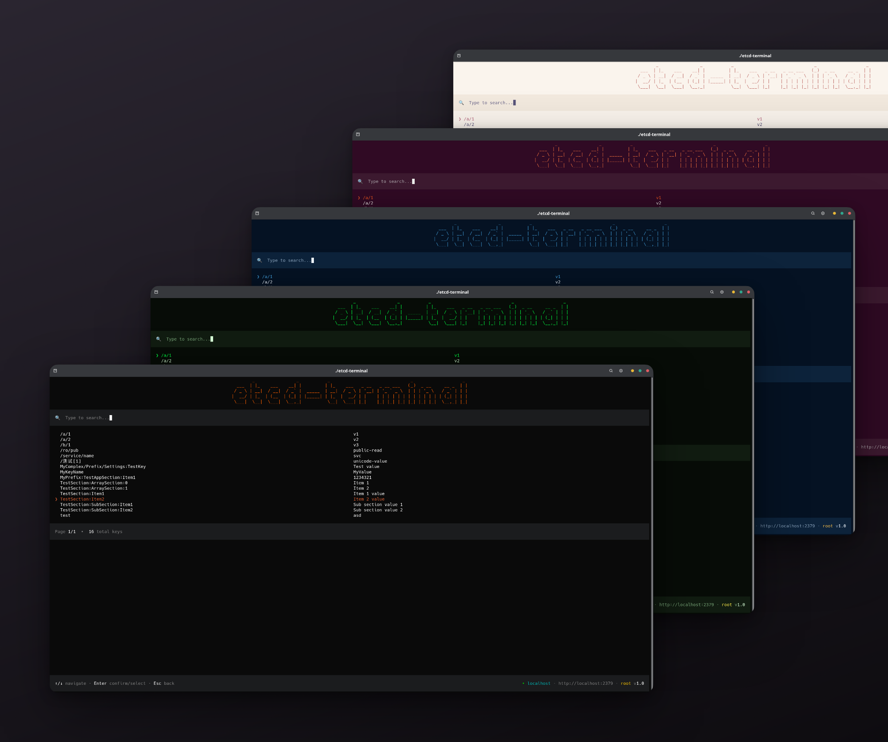
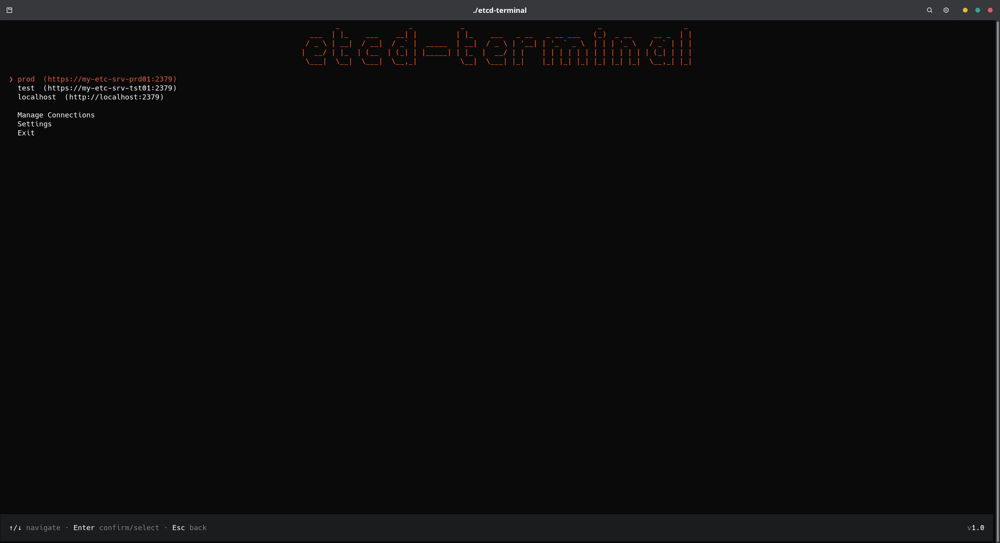
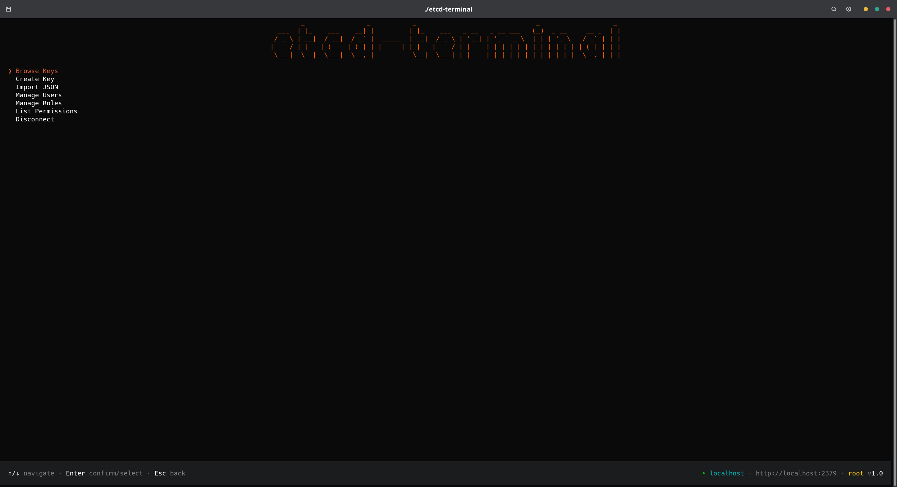
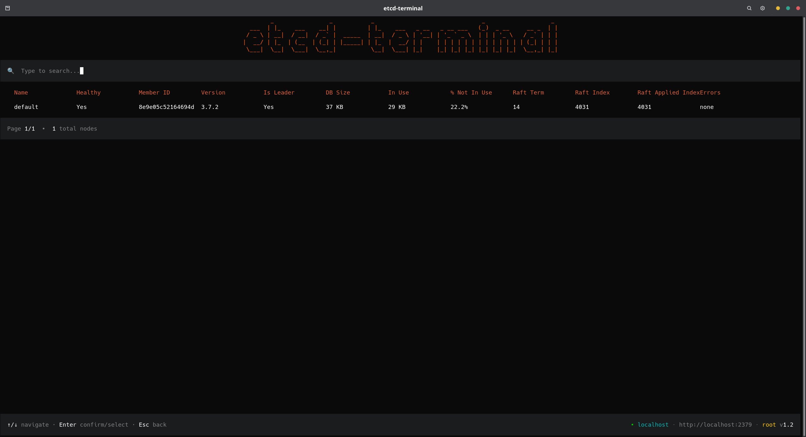
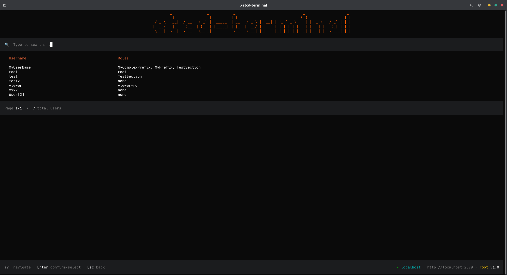
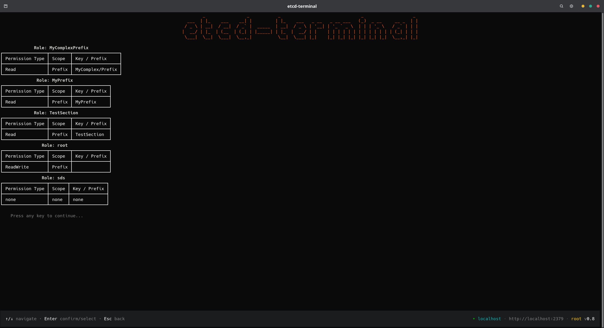

# etcd-terminal


**etcd-terminal** is an interactive terminal client for managing etcd v3+ clusters. It uses a text UI built with Spectre.Console.

[](https://github.com/SimplifyNet/etcd-terminal/releases)
[](https://github.com/SimplifyNet/etcd-terminal/blob/master/LICENSE)



## Table of contents

- [Features](#features)
  - [Connection management](#connection-management)
  - [Key and value management](#key-and-value-management)
  - [User and role management (RBAC)](#user-and-role-management-rbac)
  - [Cluster monitoring](#cluster-monitoring)
  - [Preferences](#preferences)
- [Screenshots](#screenshots)
  - [Instance selection](#instance-selection)
  - [Main menu](#main-menu)
  - [Cluster status](#cluster-status)
  - [Users](#users)
  - [Roles](#roles)
- [Configuration](#configuration)
- [Performance notes](#performance-notes)
- [Installation](#installation)
  - [Arch Linux](#arch-linux)
  - [Debian / Ubuntu](#debian--ubuntu)
- [Requirements](#requirements)
- [Building](#building)

## Features

### Connection management
- Save multiple named instances and select one when the app starts
- Add, edit, remove, and reorder saved instances
- Connect over HTTP or HTTPS, with optional username/password authentication
- Saved passwords are encrypted in the configuration file

### Key and value management
- **Browse** — view readable keys in a paginated list; available keys respect the connected account's permissions
- **Search** — filter the loaded list locally by key or value; matching is case-insensitive unless case sensitive search is enabled in preferences
- **Create** — add a key and value
- **Edit / delete** — change or remove a selected key when the account has write access to it
- **Import JSON** — paste a JSON object or array, choose a key separator and optional prefix, preview the resulting keys, then confirm import; nested objects and arrays are flattened into keys

### User and role management (RBAC)
- **Users** — list, create, delete, change passwords, and assign or remove roles
- **Roles** — list, create, and delete roles
- **Permissions** — grant or revoke read, write, or read/write access to a key or key prefix
- **Permission overview** — browse the effective user-to-role-to-permission assignments
- Authentication management is available when authentication is disabled or the connected account has the etcd root role; key actions are limited to the permissions of the connected account

### Cluster monitoring
- **Cluster status** — view every etcd member as a table with health, node ID, version, leader flag, database size and usage, raft term/index/applied index, and reported errors
- Health is derived from each member's status response; unreachable members are marked unhealthy

### Preferences
- Choose the interface language: English, Russian, or Chinese
- Choose from the built-in color themes
- Set the page size (1-500 items), whether input values are trimmed, and whether search is case sensitive
- Preferences are saved alongside connection configuration

## Screenshots

### Instance selection



### Main menu



### Cluster status



### Users



### Roles



## Configuration

Configuration and preferences are stored in `~/.config/etcd-terminal/config.json`
under the current user's home directory (for example, `%USERPROFILE%\.config\etcd-terminal\config.json` on Windows).

Example configuration:

```json
{
  "Instances": [
    {
      "Name": "Local etcd",
      "ConnectionString": "http://localhost:2379"
    },
    {
      "Name": "Secured cluster",
      "ConnectionString": "https://etcd.example.com:2379",
      "Username": "admin"
    }
  ]
}
```

Add or edit connections in the app to save a password. Passwords are encrypted,
but the encryption key is stored next to the configuration (`.key` in the same
directory). This helps protect against other local users, but not anyone who can
read your home directory.

## Performance notes

- Key browsing loads all keys readable by the connected account before filtering and pagination. On large keyspaces, loading and local search may be slow.
- User and role listings make one etcd request per listed entry in addition to the initial list request.
- Cluster status queries each member's advertised client URL for its status; a member that does not answer within a few seconds is shown as unhealthy.
- Import writes keys individually. If it is cancelled or an entry fails, earlier successful writes are not rolled back.

## Installation

Prebuilt binaries for Linux and Windows are available on the [Releases page](https://github.com/SimplifyNet/etcd-terminal/releases).

- Download the archive matching your platform and extract it.
- Run `etcd-terminal` (Linux) or `etcd-terminal.exe` (Windows).
- **Self-contained** archives (suffixed `-self-contained`) include the .NET runtime and need no extra installation.
- **Framework-dependent** archives (without the suffix) require the [.NET 10.0 Runtime](https://dotnet.microsoft.com/download/dotnet/10.0).

### Arch Linux

Each release includes a prebuilt package (`etcd-terminal-bin-<version>-1-x86_64.pkg.tar.zst`), which can be installed directly:

```bash
sudo pacman -U etcd-terminal-bin-<version>-1-x86_64.pkg.tar.zst
```

### Debian / Ubuntu

The recommended way to install is from the PPA. Packages are published for Ubuntu 26.10 (Stonking Stingray), 26.04 LTS (Resolute Raccoon), and 24.04 LTS (Noble Numbat):

```bash
sudo add-apt-repository ppa:simplifynet/etcd-terminal
sudo apt update
sudo apt install etcd-terminal
```

Alternatively, each release includes prebuilt `.deb` packages for amd64. Use the file matching your Ubuntu series, for example `~stonking`, `~resolute`, or `~noble`:

```bash
sudo apt install ./etcd-terminal_<version>-1~ppa1~<series>_amd64.deb
```

Help packaging the app for other Linux package managers (rpm/AppImage/etc.) is very welcome!

## Requirements

- etcd v3+ cluster
- .NET 10.0 Runtime for framework-dependent builds (self-contained builds bundle it)
- .NET 10.0 SDK to build or run from source

## Building

Requires the [.NET 10.0 SDK](https://dotnet.microsoft.com/download).

```bash
dotnet build src/EtcdTerminal.slnx
```
